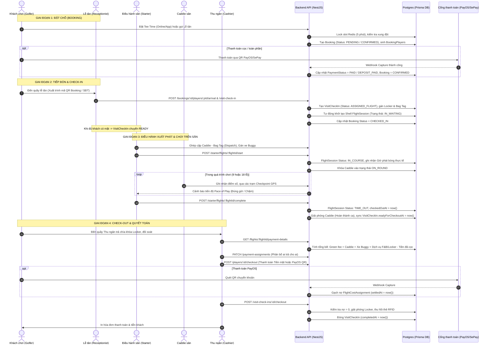
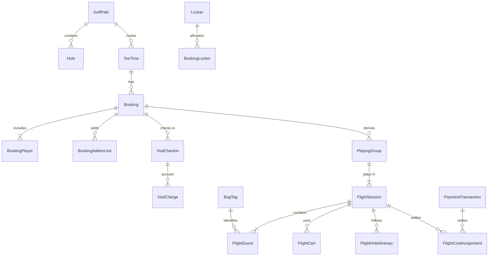

# TỔNG QUAN CHU TRÌNH VẬN HÀNH END-TO-END HỆ THỐNG ALOGOLF

> **Tài liệu Phân tích Nghiệp vụ & Kiến trúc Vận hành Hệ thống**  
> **Phiên bản:** 1.0 | **Ngày lập:** 2026-10-23  
> **Tác giả:** Senior Business Analyst & Technical Writer  
> **Phạm vi hệ thống:** AloGolf Course Management System (ERP Business Suite)

---

## 1. GIỚI THIỆU CHUNG & MỤC TIÊU VẬN HÀNH

Hệ thống quản lý sân golf **AloGolf** là nền tảng quản trị tổng thể hoạt động sân golf nhiều đường chơi (multi-path / multi-course). Hệ thống liên kết chặt chẽ từ khâu đặt giờ phát bóng (Online Booking / Walk-in), tiếp đón tại quầy & Kiosk (Check-in, cấp tủ Locker, Bag Tag), điều phối lượt chơi trên sân (Starter Flight Management, Caddie & Buggy Dispatch, Giám sát nhịp độ chơi Pace of Play) cho đến giai đoạn thanh quyết toán chi phí và giải phóng tài nguyên (Check-out & Multi-channel Payment).

### Chuỗi giá trị khép kín (End-to-End Operational Lifecycle)
```
[1. BOOKING]          [2. CHECK-IN]         [3. FLIGHT MGMT]       [4. CHECK-OUT]         [5. PAYMENT]
  Đặt chỗ tee time  ->  Tiếp đón golfer  ->   Điều hành ra sân   ->  Tính tiền & trả đồ ->  Quyết toán công nợ
  Hold slot 5 phút      Quét mã QR/SĐT        Ghép/tách Flight       Bảng kê chi phí        Tiền mặt / PayOS
  Bảng giá đa tầng      Cấp Locker & BagTag   Gán Caddie & Buggy     Phân bổ Payer/Bene     Nhả Locker & BagTag
  Xác nhận/Cọc          Khai mở VisitCheckIn  Theo dõi nhịp độ Pace  In hóa đơn chi tiết    Đóng lượt chơi
```

---

## 2. MA TRẬN PHÂN QUYỀN VAI TRÒ NHÂN VIÊN (RBAC / CASL)

Theo thiết kế kiểm soát truy cập dựa trên vai trò phân quyền chi tiết (RBAC & CASL rules) tại [`libs/shared/api-interfaces/src/lib/business-modules.ts`](file:///d:/Projects/alogolf/libs/shared/api-interfaces/src/lib/business-modules.ts) và [`libs/shared/api-interfaces/src/lib/ops-permission-presets.ts`](file:///d:/Projects/alogolf/libs/shared/api-interfaces/src/lib/ops-permission-presets.ts):

| Vai trò nghiệp vụ | Nhóm quyền (`OpsPermissionGroupKey`) | Business Module Keys được kích hoạt | Phân hệ / Màn hình thao tác chính |
| :--- | :--- | :--- | :--- |
| **Lễ tân sân** *(Receptionist)* | `ops.reception` | `ops.tee-times`, `ops.bookings`, `ops.check-in`, `ops.check-out` | `(admin)/business/operations/bookings`<br>`(admin)/business/operations/check-in`<br>`(admin)/business/operations/check-out` |
| **Điều hành sân** *(Starter / Marshal)* | `ops.starter` | `ops.flights`, `ops.flight-management`, `ops.starter-create-flight`, `ops.caddie-dispatch` | `(admin)/business/operations/flight-management`<br>`(admin)/business/operations/flights`<br>`(admin)/business/operations/starter-create-flight`<br>`(admin)/business/operations/caddie-dispatch` |
| **Caddie / Caddie Master** | `ops.caddy` | `caddie.shifts`, `caddie.schedule`, `caddie.management`, `caddie.operations`, `caddie.reports` | `(caddy)/*`<br>`(admin)/business/caddie/*` |
| **Thu ngân** *(Cashier)* | `ops.reception` / `finance` | `ops.check-out`, `finance.pos`, `finance.invoices`, `settings.payment` | `(admin)/business/operations/check-out`<br>`(admin)/business/finance/*` |
| **Kiosk tự phục vụ** *(Device)* | `ops.kiosk` | `assets.kiosks`, `ops.check-in` | `apps/webapp/src/app/kiosk/*`<br>`apps/webapp/src/app/(player-checkout-popup)/*` |
| **Quản lý vận hành** *(Ops Manager)* | `ops.manager` | Kế thừa toàn bộ module `operations`, `caddie`, `assets`, `reports`, `settings` | Toàn quyền cấu hình bảng giá, sân golf, hủy đổi khẩn cấp |

---

## 3. SƠ ĐỒ DÒNG DỮ LIỆU LIÊN MODULE (END-TO-END SEQUENCE)

Sơ đồ thể hiện chu trình di chuyển của thực thể dữ liệu từ khi đặt giờ chơi đến khi khách rời khỏi sân golf:



---

## 4. BẢNG TỔNG HỢP CÁC THỰC THỂ DỮ LIỆU & QUAN HỆ CỐT LÕI

Mô hình dữ liệu Prisma được chuẩn hóa theo kiến trúc quan hệ đa tầng:



1. **`TeeTime`** ([`booking.prisma`](file:///d:/Projects/alogolf/libs/backend/database/prisma/models/booking.prisma#L10-L37)): Quản lý khung giờ phát bóng, gắn liền với sân/đường chơi (`GolfPathId`), quy định số người tối đa (`maxPlayersPerTeeTime = 4`) và các số lỗ được phép chơi (`holeOptions = [9, 18]`).
2. **`Booking`** ([`booking.prisma`](file:///d:/Projects/alogolf/libs/backend/database/prisma/models/booking.prisma#L87-L138)): Đơn đặt sân mang mã công khai `publicCode` (ví dụ: `BK-261023-A01`), lưu số tiền cọc, số tiền đã trả, ảnh chụp cấu trúc giá `pricingSnapshot`, hạn giữ thanh toán `paymentExpiresAt`.
3. **`BookingPlayer`** ([`booking.prisma`](file:///d:/Projects/alogolf/libs/backend/database/prisma/models/booking.prisma#L140-L171)): Danh sách người chơi trong đơn đặt, lưu thông tin định danh golfer, caddie chỉ định, tủ Locker, túi golf `bagTagId`, thời điểm điểm danh tiếp đón `checkedInAt`.
4. **`VisitCheckIn`** ([`visit.prisma`](file:///d:/Projects/alogolf/libs/backend/database/prisma/models/visit.prisma#L112-L148)): Thực thể quản lý lượt khách có mặt tại sân trong ngày, lưu mã thẻ RFID locker `lockerCardUid`, thời điểm sẵn sàng thanh toán `readyForCheckoutAt` và thời điểm thanh toán xong `completedAt`.
5. **`PlayingGroup` & `FlightSession`** ([`course.prisma`](file:///d:/Projects/alogolf/libs/backend/database/prisma/models/course.prisma#L421-L565)): Nhóm chơi và phiên thi đấu thực tế trên sân mang mã flight số hiệu `code` (ví dụ `FL026000001`), điều phối danh sách người chơi `FlightGuest`, xe điện `FlightCart`, danh sách lỗ `FlightHoleItinerary`.
6. **`FlightCostAssignment`** ([`flight-cost-assignment.prisma`](file:///d:/Projects/alogolf/libs/backend/database/prisma/models/flight-cost-assignment.prisma#L1-L25)): Bảng quyết toán chi tiết phân bổ công nợ từng dòng chi phí (`lineKey`), ghi rõ người thụ hưởng (`beneficiaryGuestId`) và người chịu trách nhiệm thanh toán (`payerGuestId`).
7. **`PaymentTransaction`** ([`booking.prisma`](file:///d:/Projects/alogolf/libs/backend/database/prisma/models/booking.prisma#L187-L216)): Giao dịch cổng thanh toán (PayOS / SePay) lưu số hóa đơn `orderInvoiceNumber`, mã đơn cổng `providerMerchantOrderRef`, trạng thái giao dịch (`status`) và liên kết webhook đối soát.

---

## 5. DANH MỤC CÁC ĐIỂM CHƯA ĐỦ BẰNG CHỨNG (CẦN XÁC NHẬN)

Trong quá trình đối chiếu mã nguồn thực tế, các quy tắc nghiệp vụ sau cần được Ban Quản Lý Sân / Đội ngũ Nghiệp Vụ xác nhận chính thức:

1. `[CẦN XÁC NHẬN]` **Chính sách hoàn cọc khi hủy Booking**: Khi khách tự hủy booking trên ứng dụng hoặc lễ tân hủy, hệ thống hiện tại cập nhật trạng thái `CANCELLED` và giải phóng slot giữ chỗ, nhưng chưa có luồng tự động gọi Refund API của PayOS/SePay hoàn tiền vào tài khoản ngân hàng của golfer. Tiền cọc hoàn thủ công hay tạo Voucher bù đắp?
2. `[CẦN XÁC NHẬN]` **Xử lý sự cố gián đoạn thời tiết (Rain Check Policy)**: Khi sân có mưa to hoặc bão, Starter bấm dừng trận chơi, hệ thống chưa có quy tắc tự động chia tỉ lệ tiền sân theo số lỗ đã chơi thực tế (ví dụ: chơi được 5/18 lỗ thì tính giá 9 lỗ hay tính theo lỗ lẻ?). Hiện tại Thu ngân phải nhập dòng phụ phí giảm trừ thủ công (`MANUAL` negative charge hoặc điều chỉnh dòng tiền).
3. `[CẦN XÁC NHẬN]` **Quy tắc trễ giờ xuất phát (Tee-off Delay & Buffer Time)**: Thời gian cho phép trễ tối đa so với giờ Tee Time đã đặt trước khi hệ thống hoặc Starter đánh dấu `NO_SHOW` là bao nhiêu phút (15 phút hay 30 phút)?
4. `[CẦN XÁC NHẬN]` **Định mức tiền Tip Caddie qua cổng điện tử**: Hệ thống hiện tại ghi nhận phí phục vụ Caddie chuẩn trong bill, việc tip thêm cho Caddie qua mã QR cá nhân của Caddie có đưa vào hóa đơn tổng sân hay Caddie tự nhận riêng?
