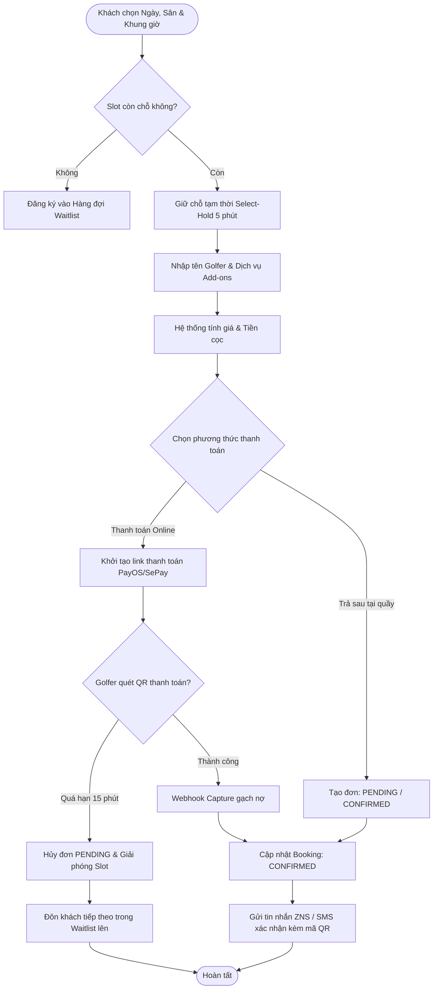
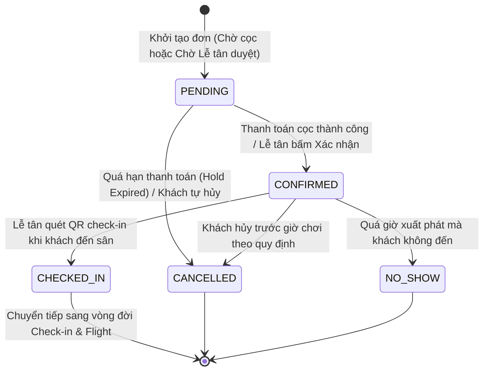

# QUY TRÌNH NGHIỆP VỤ: ĐẶT CHỖ SÂN GOLF (BOOKING MODULE)

> **Tài liệu Phân tích Nghiệp vụ & Đặc tả Kỹ thuật**  
> **Module:** Tee Time Management & Online/Reception Booking  
> **Phiên bản:** 1.0 | **Ngày lập:** 2026-10-23  
> **Tác giả:** Senior Business Analyst & Technical Writer

---

## 1. TỔNG QUAN & PHẠM VI NGHIỆP VỤ

Module Booking chịu trách nhiệm quản lý toàn bộ năng lực phục vụ của sân golf theo từng khung giờ phát bóng (Tee Time Slots), đường chơi (Golf Paths), chính sách giá linh hoạt theo thứ trong tuần/ngày lễ, và tiếp nhận đặt chỗ từ hai kênh chính:
1. **Golfer tự đặt online:** Thông qua ứng dụng di động AloGolf Mobile hoặc Cổng mạng xã hội/Web.
2. **Lễ tân tạo đặt chỗ tại quầy:** Tiếp nhận qua điện thoại, email hoặc khách đến đặt trực tiếp tại quầy tiếp tân (Reception Desk).

---

## 2. BẢN ĐỒ GIAO DIỆN, API, SERVICE VÀ DATABASE

### 2.1. Màn hình giao diện (Screens / Webapp Routes)
- **Danh sách & Bộ lọc Booking:** [`apps/webapp/src/app/(admin)/business/operations/bookings/page.tsx`](file:///d:/Projects/alogolf/apps/webapp/src/app/(admin)/business/operations/bookings/page.tsx)  
  *Component cốt lõi:* [`ReceptionOperationsPage variant="bookingList"`](file:///d:/Projects/alogolf/apps/webapp/src/features/reception/components/reception-operations-page.tsx), [`reception-bookings-table.tsx`](file:///d:/Projects/alogolf/apps/webapp/src/features/reception/components/reception-bookings-table.tsx), [`reception-booking-list-filters.tsx`](file:///d:/Projects/alogolf/apps/webapp/src/features/reception/components/reception-booking-list-filters.tsx).
- **Form tạo Booking tại quầy lễ tân (Wizard 3 bước):** [`reception-create-booking-form.tsx`](file:///d:/Projects/alogolf/apps/webapp/src/features/reception/components/reception-create-booking-form.tsx)  
  - Bước 1: Chọn ngày, đường chơi, khung giờ Tee Time & số người chơi ([`reception-create-booking-select-step.tsx`](file:///d:/Projects/alogolf/apps/webapp/src/features/reception/components/reception-create-booking-select-step.tsx)).
  - Bước 2: Nhập thông tin golfer, dịch vụ đi kèm add-ons, chọn caddie mong muốn ([`reception-create-booking-confirm-step.tsx`](file:///d:/Projects/alogolf/apps/webapp/src/features/reception/components/reception-create-booking-confirm-step.tsx)).
  - Bước 3: Xem tóm tắt chi phí, chọn hình thức thanh toán & xác nhận hoàn tất ([`reception-create-booking-success-step.tsx`](file:///d:/Projects/alogolf/apps/webapp/src/features/reception/components/reception-create-booking-success-step.tsx)).
- **Chi tiết Booking (Drawer Sheet):** [`reception-booking-detail-sheet.tsx`](file:///d:/Projects/alogolf/apps/webapp/src/features/reception/components/reception-booking-detail-sheet.tsx) hiển thị chi tiết mã đơn, danh sách người chơi, caddie gán trước, dịch vụ add-on và nhật ký thanh toán.
- **Quản lý Khung giờ & Bảng giá:** `(admin)/business/operations/tee-times` ([`reception-golf-pricing-tab.tsx`](file:///d:/Projects/alogolf/apps/webapp/src/features/reception/components/reception-golf-pricing-tab.tsx)).

### 2.2. Danh mục API Endpoints (Backend Controller)
Khai báo tại [`OrganizationBookingsController`](file:///d:/Projects/alogolf/libs/backend/bookings/src/lib/controllers/organization-bookings.controller.ts):

| Phương thức | Đường dẫn API | Guards & Quyền CASL | Tác vụ nghiệp vụ |
| :--- | :--- | :--- | :--- |
| `GET` | `/organizations/:orgId/tee-times` | `Roles(GOLFER, MANAGER)` | Tra cứu danh sách khung giờ trống theo ngày & đường chơi |
| `POST` | `/organizations/:orgId/tee-times/:id/hold` | `Roles(GOLFER, MANAGER)` | Giữ chỗ độc quyền 5 phút (`Select-Hold`) để tránh đặt trùng |
| `DELETE`| `/organizations/:orgId/tee-times/:id/hold` | `Roles(GOLFER, MANAGER)` | Nhả quyền giữ chỗ khi người dùng hủy thao tác |
| `POST` | `/organizations/:orgId/bookings` | `RequireAbility(create, Booking)` | Tạo mới Booking (Kèm `Idempotency-Key` trên Header) |
| `GET` | `/organizations/:orgId/bookings` | `RequireAbility(read, Booking)` | Lấy danh sách booking phân trang cho Lễ tân |
| `GET` | `/organizations/:orgId/bookings/:id/manage`| `RequireAbility(read, Booking)`| Xem chi tiết đầy đủ thông tin booking cho nhân viên quản lý |
| `PATCH` | `/organizations/:orgId/bookings/:id` | `RequireAbility(update, Booking)` | Lễ tân cập nhật trạng thái đơn (CONFIRMED / CANCELLED / NO_SHOW) |
| `PATCH` | `/organizations/:orgId/bookings/:id/payment-status` | `RequireAbility(update, Booking)` | Cập nhật trạng thái thanh toán (PAID / DEPOSIT_PAID / REFUNDED) |
| `POST` | `/organizations/:orgId/bookings/:id/cancel` | `Roles(GOLFER, MANAGER)` | Golfer tự hủy đơn đặt của chính mình |
| `POST` | `/organizations/:orgId/booking-waitlist` | `Roles(GOLFER, MANAGER)` | Đăng ký hàng đợi chờ slot khi khung giờ đã đầy khách |
| `POST` | `/organizations/:orgId/booking-waitlist/:id/confirm` | `Roles(GOLFER, MANAGER)` | Chấp nhận slot vừa được nhả và chuyển thành booking chính thức |

### 2.3. Các Services & Hàm xử lý thực tế
1. **[`BookingsCreateService.create`](file:///d:/Projects/alogolf/libs/backend/bookings/src/lib/services/booking/bookings-create.service.ts#L42-L230):**
   - Kiểm tra `Idempotency-Key` chống tạo đơn trùng lặp qua `persistence.findByIdempotency`.
   - Xác thực người đặt có đang giữ `Select-Hold` hợp lệ hay không qua `selectHold.assertHolder`.
   - Chiếm giữ slot hold bằng Redis TTL qua `slotHold.acquire`.
   - Tính toán biểu phí tự động qua `pricing.compute`.
   - Tạo bản ghi `Booking`, `BookingPlayer`, `BookingAddonLine` và kích hoạt side-effects (gửi tin nhắn thông báo, broadcast WebSocket).
2. **[`BookingPricingService.compute`](file:///d:/Projects/alogolf/libs/backend/bookings/src/lib/services/booking/booking-pricing.service.ts):**
   - Khớp khung giờ Tee Time với phiên bản bảng giá `PricingScheduleVersion` đang có hiệu lực (`ACTIVE`).
   - Tính Green fee chuẩn, áp dụng hệ số lỗ (`hole9Multiplier = 0.6`, `hole18Multiplier = 1.0`, v.v.).
   - Cộng dồn phí dịch vụ gia tăng (`CourseServicePrice`): thuê xe điện, thuê caddie, suất ăn F&B.
   - Tính toán số tiền cọc bắt buộc theo tỷ lệ `depositRatio` (mặc định 30% tổng tiền).
3. **[`BookingNoShowService.sweepNoShows`](file:///d:/Projects/alogolf/libs/backend/bookings/src/lib/services/booking/booking-no-show.service.ts):**
   - Tự động chạy định kỳ (Cron job) quét các booking trạng thái `CONFIRMED` có giờ chơi đã quá hạn mà chưa thực hiện Check-in, chuyển trạng thái thành `NO_SHOW`.
4. **[`BookingCheckInReminderService`](file:///d:/Projects/alogolf/libs/backend/bookings/src/lib/services/booking/booking-check-in-reminder.service.ts):**
   - Quét các booking sắp đến giờ chơi (trước 15–30 phút) để gửi thông báo Zalo ZNS / SMS nhắc khách đến quầy làm thủ tục.

### 2.4. Cấu trúc Database Models (Prisma Schema)
- **`Booking`** ([`booking.prisma`](file:///d:/Projects/alogolf/libs/backend/database/prisma/models/booking.prisma#L87-L138)):
  - `publicCode`: Mã tra cứu công khai (ví dụ: `BK261023A01`).
  - `status`: `PENDING` | `CONFIRMED` | `CHECKED_IN` | `CANCELLED` | `NO_SHOW`.
  - `paymentTerm`: `PAY_FULL` | `PAY_DEPOSIT` | `PAY_ON_CHECKOUT`.
  - `paymentStatus`: `PENDING` | `DEPOSIT_PAID` | `PAID` | `FAILED` | `REFUNDED`.
  - `totalAmountCents`, `depositAmountCents`, `paidAmountCents`: Đơn vị tiền tệ chuẩn (Cents/VND quy đổi).
  - `pricingSnapshot`: Bản sao lưu cấu trúc giá tại thời điểm đặt đơn.
  - `paymentExpiresAt`: Thời hạn hết hạn giữ chỗ (Hold deadline).
- **`BookingPlayer`** ([`booking.prisma`](file:///d:/Projects/alogolf/libs/backend/database/prisma/models/booking.prisma#L140-L171)):
  - `displayName`: Tên hiển thị người chơi.
  - `golferAccountId`: Tài khoản golfer liên kết (nếu có).
  - `caddieAccountId`: Caddie được chỉ định trước.
  - `checkedInAt`: Thời điểm khách điểm danh có mặt tại quầy lễ tân.
- **`PricingTimeSlot`** ([`booking.prisma`](file:///d:/Projects/alogolf/libs/backend/database/prisma/models/booking.prisma#L312-L347)):
  - `dayTypes`: `[WEEKDAY, WEEKEND, HOLIDAY, MONDAY, ...]`.
  - `startTime`, `endTime`: Khung giờ áp dụng (ví dụ: "06:00" đến "08:30").
  - `domesticGreenFeeCents`, `internationalGreenFeeCents`, `depositRatio`.

---

## 3. LOGIC XỬ LÝ CHI TIẾT & SƠ ĐỒ NGHIỆP VỤ

### 3.1. Sơ đồ luồng đặt chỗ & Quản lý giữ chỗ (Hold & Expiry Flow)

### 3.2. Cơ chế chống xung đột giữ chỗ (Two-tier Hold Mechanism)
Để ngăn chặn trường hợp nhiều người cùng bấm chọn một khung giờ dẫn đến tình trạng vượt quá số lượng tối đa (`maxPlayersPerTeeTime = 4`):
1. **Tầng 1 - Select-Hold (Redis Key TTL = 300s):** Khi khách bấm chọn slot trên ứng dụng, hệ thống gọi `TeeTimeSelectHoldService.acquire` cấp quyền giữ chỗ độc quyền trong 5 phút. Nếu khách đóng ứng dụng hoặc không chuyển sang bước tiếp theo, Redis tự động giải phóng key.
2. **Tầng 2 - Slot-Hold (Hold deadline):** Sau khi bấm nút "Xác nhận đặt chỗ", hệ thống kích hoạt `BookingSlotHoldService.acquire` với thời hạn chờ thanh toán `paymentExpiresAt` (thường là 15 phút). Trong thời gian này, slot bị trừ tạm thời khỏi năng lực phục vụ của sân.

### 3.3. Quy trình xử lý Hàng đợi (Booking Waitlist)
- Khi khung giờ Tee Time hiển thị trạng thái `FULL`, golfer có thể bấm "Tham gia hàng đợi" (`POST /booking-waitlist`).
- Nếu có một đơn đặt trước đó bị hủy hoặc hết hạn thanh toán, hệ thống gọi [`BookingWaitlistPromoteService.promoteNext`](file:///d:/Projects/alogolf/libs/backend/bookings/src/lib/services/booking/booking-waitlist-promote.service.ts).
- Khách đầu hàng đợi nhận được thông báo ZNS/Push notification và có cửa sổ thời gian 15 phút (`expiresAt`) để bấm xác nhận đơn (`POST /booking-waitlist/:entryId/confirm`). Nếu quá hạn, hệ thống tự động chuyển lượt cho người kế tiếp.

---

## 4. MA TRẬN CHUYỂN ĐỔI TRẠNG THÁI BOOKING (STATE MACHINE)

---

## 5. CÁC TÌNH HUỐNG NGOẠI LỆ & XỬ LÝ LỖI

1. **Khách đặt trùng slot trên cùng một giờ chơi:**
   - Hệ thống chặn golfer thông thường tạo 2 đơn trên cùng 1 Tee Time qua `findActiveForBookerAndTeeTime`.
   - *Ngoại lệ cho nhân viên lễ tân:* Lễ tân (`role === MANAGER`) được bật cờ `allowMultipleActiveOnTeeTime: true` để có thể ghép nhiều nhóm khách lẻ (ghép 2 khách + 2 khách) vào cùng 1 khung giờ.
2. **Lỗi mạng khi gọi cổng thanh toán PayOS:**
   - Đơn giữ trạng thái `PENDING`. Khách có thể vào lại mục "Đơn đặt của tôi" (`/me/bookings/:id`) và bấm nút "Thanh toán lại" để sinh QR mới mà không bị mất chỗ đã giữ.
3. **Điều chỉnh số lượng người chơi trước ngày lên sân:**
   - Lễ tân có thể mở `reception-booking-detail-sheet.tsx`, thực hiện xóa bớt người chơi hoặc thêm người chơi mới. Hệ thống sẽ tính toán lại tổng tiền `totalAmountCents` tương ứng.

---

## 6. DANH MỤC ĐIỂM CHƯA ĐỦ BẰNG CHỨNG (CẦN XÁC NHẬN)

1. `[CẦN XÁC NHẬN]` **Khung thời gian quét tự động No-Show:** Trong file [`booking-no-show.service.ts`](file:///d:/Projects/alogolf/libs/backend/bookings/src/lib/services/booking/booking-no-show.service.ts#L35), thời gian trễ hiện tại đang cấu hình mặc định là bao nhiêu phút sau giờ `teeOffAt` trước khi chuyển sang `NO_SHOW` (15 phút, 30 phút hay 60 phút)?
2. `[CẦN XÁC NHẬN]` **Xử lý tiền cọc khi No-Show:** Khoản tiền cọc `paidAmountCents` của các đơn bị `NO_SHOW` sẽ bị tịch thu 100% sung quỹ doanh thu sân hay chuyển thành công nợ bảo lưu cho lần chơi sau?
3. `[CẦN XÁC NHẬN]` **Thời gian mở bán Tee Time trước ngày chơi:** Sân cho phép golfer đặt trước tối đa bao nhiêu ngày (7 ngày, 14 ngày hay 30 ngày)? Hiện tại API không giới hạn ngày trong tương lai nếu bảng giá đã được lập lịch sẵn (`SCHEDULED`).
