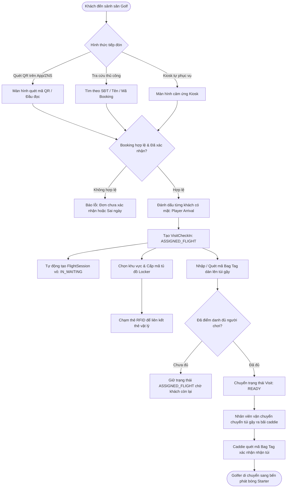

# QUY TRÌNH NGHIỆP VỤ: TIẾP ĐÓN & CHECK-IN (CHECK-IN MODULE)

> **Tài liệu Phân tích Nghiệp vụ & Đặc tả Kỹ thuật**  
> **Module:** Golfer Reception, Kiosk Self Check-In, Locker & Bag Tag Allocation  
> **Phiên bản:** 1.0 | **Ngày lập:** 2026-10-23  
> **Tác giả:** Senior Business Analyst & Technical Writer

---

## 1. TỔNG QUAN & PHẠM VI NGHIỆP VỤ

Module Tiếp đón & Check-in đóng vai trò cầu nối chuyển giao giữa giai đoạn Đặt chỗ (Booking) sang giai đoạn Ra sân thi đấu (On-Course Flight). Khi golfer có mặt tại sân golf:
1. Xác thực thông tin đơn đặt chỗ (Mã Booking công khai, SĐT, hoặc quét mã QR trên ứng dụng/ZNS).
2. Điểm danh từng người chơi trong đoàn (`BookingPlayer.checkedInAt`).
3. Gán tủ đồ cá nhân (`Locker`) và cấp thẻ tủ đồ RFID (`PhysicalCard`).
4. Gán thẻ túi gậy golf (`BagTag`) mang tiền tố xoay vòng theo ngày để phục vụ nhận diện túi gậy tại bãi tập kết và bàn giao cho caddie.
5. Kích hoạt lượt thăm sân (`VisitCheckIn`) và tự động khởi tạo Flight vỏ (`Shell FlightSession`) gửi sang phân hệ Điều hành xuất phát (Starter).

---

## 2. BẢN ĐỒ GIAO DIỆN, API, SERVICE VÀ DATABASE

### 2.1. Màn hình giao diện (Screens / Components)
- **Màn hình Lễ tân Tiếp đón (Check-in Operations Page):** [`apps/webapp/src/app/(admin)/business/operations/check-in/page.tsx`](file:///d:/Projects/alogolf/apps/webapp/src/app/(admin)/business/operations/check-in/page.tsx)  
  *Component chính:* [`ReceptionOperationsPage variant="checkIn"`](file:///d:/Projects/alogolf/apps/webapp/src/features/reception/components/reception-operations-page.tsx).
- **Bảng danh sách khách đến sân trong ngày:** [`reception-operations-table.tsx`](file:///d:/Projects/alogolf/apps/webapp/src/features/reception/components/reception-operations-table.tsx) hiển thị trạng thái từng nhóm: Giờ Tee Time, Mã Booking, Tên người đại diện, Số lượng khách đã đến / Tổng khách, Trạng thái Check-in.
- **Modal Quét QR Check-in nhanh:** [`reception-qr-scan-modal.tsx`](file:///d:/Projects/alogolf/apps/webapp/src/features/reception/components/reception-qr-scan-modal.tsx) sử dụng camera máy tính hoặc đầu đọc QR chuyên dụng để nhận diện mã `checkInCode`.
- **Form Chỉnh sửa & Gán tài nguyên Check-in:** [`reception-check-in-edit-form.tsx`](file:///d:/Projects/alogolf/apps/webapp/src/features/reception/components/reception-check-in-edit-form.tsx) và [`reception-check-in-edit-player-row.tsx`](file:///d:/Projects/alogolf/apps/webapp/src/features/reception/components/reception-check-in-edit-player-row.tsx):
  - Nhập hoặc quét mã vạch Bag Tag cho từng người chơi.
  - Chọn khu vực tủ Locker (Nam / Nữ / VIP) và số tủ đồ.
  - Chọn hoặc đổi số lỗ chơi (9, 18, 27 lỗ) theo nhu cầu thực tế của khách.
- **Giao diện Kiosk tự phục vụ:** [`apps/webapp/src/app/kiosk`](file:///d:/Projects/alogolf/apps/webapp/src/app/kiosk) dành cho màn hình cảm ứng đặt tại sảnh để khách tự thao tác.

### 2.2. Danh mục API Endpoints (Backend Controllers)
Khai báo tại [`VisitCheckInController`](file:///d:/Projects/alogolf/libs/backend/bookings/src/lib/controllers/visit-check-in.controller.ts) và [`LockersController`](file:///d:/Projects/alogolf/libs/backend/lockers/src/lib/controllers/lockers.controller.ts):

| Phương thức | Đường dẫn API | Quyền CASL | Tác vụ nghiệp vụ |
| :--- | :--- | :--- | :--- |
| `GET` | `/organizations/:orgId/visit-check-ins` | `RequireAbility(read, ReceptionOps)` | Lấy danh sách lượt khách đang làm thủ tục tiếp đón |
| `POST` | `/organizations/:orgId/bookings/:id/players/:pId/arrival` | `RequireAbility(update, KioskOps)` | Điểm danh đánh dấu một golfer cụ thể đã đến sân |
| `POST` | `/organizations/:orgId/bookings/:id/visit-check-in` | `RequireAbility(update, KioskOps)` | Mở lượt khách `VisitCheckIn`, cập nhật Booking = `CHECKED_IN` |
| `POST` | `/organizations/:orgId/bookings/:id/players/:pId/kiosk-check-in` | `RequireAbility(update, KioskOps)` | Khách tự check-in định danh và gán Bag tag tại Kiosk |
| `POST` | `/organizations/:orgId/visit-check-ins/:id/link-locker-card` | `RequireAbility(update, KioskOps)` | Quét liên kết mã UID thẻ vật lý RFID với tủ Locker của khách |
| `POST` | `/organizations/:orgId/visit-check-ins/:id/ready` | `RequireAbility(update, ReceptionOps)` | Đánh dấu thủ tục tiếp đón hoàn tất, sẵn sàng ra sân (`READY`) |
| `POST` | `/organizations/:orgId/visit-check-ins/:id/cancel` | `RequireAbility(update, ReceptionOps)` | Hủy thủ tục check-in (Hoàn trả booking về `CONFIRMED`) |
| `POST` | `/organizations/:orgId/caddy/bag-tag-handoff` | `RequireAbility(update, CaddyOps)` | Caddie quét mã Bag Tag xác nhận đã tiếp nhận túi gậy của golfer |

### 2.3. Logic xử lý Backend & Dẫn chứng mã nguồn
1. **Khởi tạo Visit & Sinh Shell Flight:** [`VisitLifecycleService.openVisit`](file:///d:/Projects/alogolf/libs/backend/bookings/src/lib/services/visits/visit-lifecycle.service.ts#L36-L136):
   - Kiểm tra trạng thái Booking phải là `CONFIRMED` hoặc `CHECKED_IN`.
   - Tạo bản ghi `VisitCheckIn` với trạng thái `ASSIGNED_FLIGHT`.
   - Cập nhật `Booking.status = 'CHECKED_IN'`.
   - Gọi hàm [`createShellFlightFromBooking`](file:///d:/Projects/alogolf/libs/backend/bookings/src/lib/services/visits/visit-lifecycle.service.ts#L110): Khởi tạo một thực thể `FlightSession` vỏ với mã số tự sinh (ví dụ `FL026000001`), chuyển trạng thái flight thành `IN_WAITING` để hiển thị ngay trên màn hình của nhân viên Starter.
   - Kiểm tra nếu toàn bộ người chơi trong đoàn đã có mặt (`maybePromoteVisitReadyWhenAllPlayersCheckedIn`), hệ thống tự động thăng cấp `VisitCheckIn.status = 'READY'`.
2. **Quy trình gán Thẻ tủ Locker:** [`LockerAssignmentService.assign`](file:///d:/Projects/alogolf/libs/backend/lockers/src/lib/services/locker-assignment.service.ts):
   - Kiểm tra trạng thái tủ trong bảng `Locker` phải là `AVAILABLE`.
   - Tạo bản ghi `BookingLocker` gắn với `bookingPlayerId` và `visitCheckInId`.
   - Cập nhật trạng thái tủ thành `OCCUPIED`.
   - Ghi lại lịch sử cấp phát vào `LockerHistory`.
3. **Quy trình cấp phát Bag Tag (Túi gậy):** [`resolveOrCreateActiveBagTagId`](file:///d:/Projects/alogolf/libs/backend/database/prisma/models/visit.prisma#L44-L71):
   - Hệ thống kiểm tra mã thẻ túi gậy `uid` (ví dụ `A012`). Nếu chưa tồn tại trong kho tài nguyên, tự động tạo mới `BagTag`.
   - Chuyển trạng thái `BagTag.status` từ `AVAILABLE` sang `OCCUPIED`, gán vào `BookingPlayer.bagTagId` và lưu lịch sử `BagTagHistory`.
4. **Hủy thủ tục Check-in (Rollback):** [`VisitLifecycleService.cancelVisit`](file:///d:/Projects/alogolf/libs/backend/bookings/src/lib/services/visits/visit-lifecycle.service.ts#L250-L346):
   - Chuyển `VisitCheckIn.status = 'CANCELLED'`.
   - Hoàn trả trạng thái `Booking.status = 'CONFIRMED'`.
   - Giải phóng tủ đồ Locker, hủy hiệu lực thẻ vật lý RFID (`PhysicalCard.status = 'REVOKED'`).
   - Hủy bỏ các Flight vỏ `IN_WAITING` vừa sinh ra và nhả lại caddie nếu đã phân công trước đó.

---

## 3. SƠ ĐỒ NGHIỆP VỤ CHECK-IN & PHÂN BỔ TÀI NGUYÊN

---

## 4. CHI TIẾT TÀI NGUYÊN CHECK-IN: LOCKER & BAG TAG

### 4.1. Cơ chế xoay vòng tiền tố Bag Tag theo ngày (Daily Rotating Prefix)
Theo mô hình [`BagTagDailyPrefix`](file:///d:/Projects/alogolf/libs/backend/database/prisma/models/visit.prisma#L95-L104):
- Mỗi ngày làm việc (work date), sân golf tự động gán một ký tự tiền tố đại diện (từ `A` đến `Z`, ví dụ Thứ 2: `A`, Thứ 3: `B`, ...).
- Mã túi gậy được định dạng: `[Tiền tố ngày] + [Số thứ tự]` (Ví dụ: `A001`, `A002`... `B001`).
- **Mục đích nghiệp vụ:**
  - Giúp nhân viên bãi tập kết gậy và Caddie nhận diện ngay túi gậy của ngày hôm nay, tránh nhầm lẫn với các túi gậy của khách chơi ca hôm trước để quên hoặc gửi lại qua đêm.
  - Khi Caddie nhận túi gậy từ khu vực tiếp đón, Caddie thực hiện thao tác quét hoặc nhập mã trên ứng dụng Caddie (`POST /caddy/bag-tag-handoff`) để xác nhận trách nhiệm bảo quản túi gậy suốt trận chơi.

### 4.2. Cơ chế phân bổ và khóa thẻ tủ Locker
- Hệ thống hỗ trợ chia các khu vực tủ (`LockerArea`): Khu Nam, Khu Nữ, Khu Hội viên VIP, Khu Khách mời.
- Tủ Locker có 4 trạng thái:
  - `AVAILABLE`: Sẵn sàng cấp phát.
  - `OCCUPIED`: Đang có khách sử dụng (khóa không cho cấp trùng).
  - `MAINTENANCE`: Đang bảo trì / kẹt khóa.
  - `RETIRED`: Ngừng sử dụng.
- Thẻ vật lý RFID (`PhysicalCard`) được gán trực tiếp với `VisitCheckIn` và tự động thu hồi / hủy kích hoạt (`REVOKED`) ngay khi khách làm thủ tục Check-out ra về.

---

## 5. CÁC TÌNH HUỐNG NGOẠI LỆ & XỬ LÝ LỖI

1. **Khách vãng lai (Walk-in) chưa có Booking trước:**
   - Lễ tân có 2 phương án:
     - *Phương án A:* Vào màn hình Đặt chỗ (`bookings/page.tsx`), tạo nhanh một Booking với tùy chọn "Thanh toán tại quầy" (`PAY_ON_CHECKOUT`) rồi bấm Check-in ngay.
     - *Phương án B:* Hướng dẫn khách ra thẳng bến Starter, Starter sử dụng tính năng `Create Walk-in Flight` trực tiếp tại bến phát bóng.
2. **Khách thay đổi số lỗ chơi tại quầy (Đổi từ 18 lỗ xuống 9 lỗ hoặc lên 27 lỗ):**
   - Lễ tân thực hiện trên form [`reception-check-in-edit-form.tsx`](file:///d:/Projects/alogolf/apps/webapp/src/features/reception/components/reception-check-in-edit-form.tsx).
   - Hệ thống gọi API `PATCH /bookings/:id/check-in-details` để ghi nhận `holeCountAdjustedAt`, `holeCountAdjustedReason`. Cấu trúc giá sẽ được cập nhật lại tương ứng để làm căn cứ cho Thu ngân tính tiền ở chặng cuối.
3. **Khách làm mất thẻ Locker:**
   - Lễ tân vào quản lý Locker, thực hiện thao tác `Thu hồi thẻ cũ (Revoke)` và gán thẻ mới (`Re-link Card`) cho khách. Hệ thống tự động ghi nhật ký vào `LockerHistory` để tính phí bồi thường mất thẻ (nếu sân có quy định).

---

## 6. DANH MỤC ĐIỂM CHƯA ĐỦ BẰNG CHỨNG (CẦN XÁC NHẬN)

1. `[CẦN XÁC NHẬN]` **Quy tắc phân bổ tủ Locker tự động:** Hệ thống hiện tại cho phép Lễ tân tự chọn số tủ từ danh sách sổ xuống, tính năng "Auto-assign Locker" (tự động chọn số tủ gần nhau cho nhóm bạn đi cùng nhau) đã được cài đặt thuật toán hay phụ thuộc hoàn toàn vào nhân viên lễ tân bấm chọn?
2. `[CẦN XÁC NHẬN]` **Xử lý túi gậy đôi (2 bộ gậy trong 1 túi):** Trường hợp 2 vợ chồng đi chung 1 túi golf nhưng chơi 2 người thì gán 1 mã Bag Tag cho 2 người chơi hay bắt buộc mỗi người phải có 1 mã Bag Tag riêng biệt?
3. `[CẦN XÁC NHẬN]` **Thời hạn tối đa giữ đồ trong tủ Locker sau giờ chơi:** Khách sau khi đánh xong có được gửi lại đồ qua đêm không? Nếu qua đêm hệ thống có tự động cộng phí lưu tủ (`OVERNIGHT_LOCKER_CHARGE`) vào bill ngày hôm sau không?
