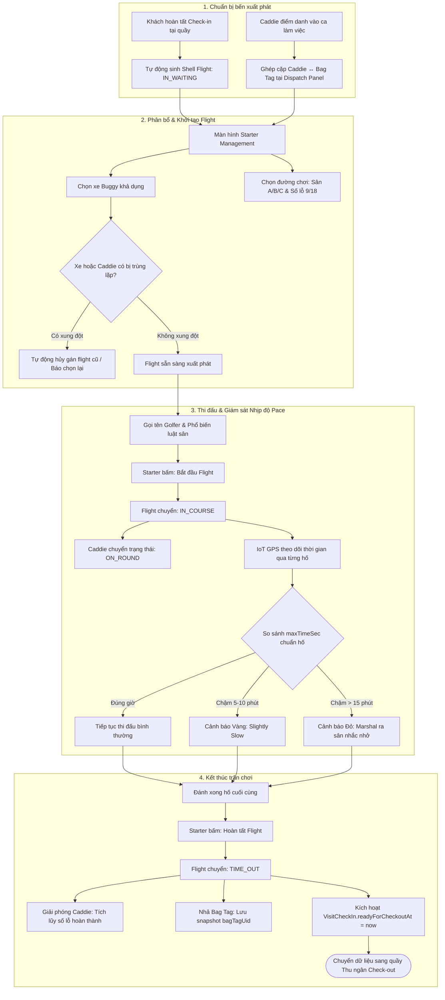

# QUY TRÌNH NGHIỆP VỤ: ĐIỀU HÀNH FLIGHT & XUẤT PHÁT (FLIGHT MANAGEMENT / STARTER MODULE)

> **Tài liệu Phân tích Nghiệp vụ & Đặc tả Kỹ thuật**  
> **Module:** Starter Desk, On-Course Operations, Caddie & Buggy Dispatch, Pace of Play Tracking  
> **Phiên bản:** 1.0 | **Ngày lập:** 2026-10-23  
> **Tác giả:** Senior Business Analyst & Technical Writer

---

## 1. TỔNG QUAN & PHẠM VI NGHIỆP VỤ

Module Điều hành Flight (Starter / Marshal) là trái tim vận hành trên sân golf, phụ trách tổ chức và kiểm soát toàn bộ hoạt động xuất phát và di chuyển của các nhóm chơi (Flights):
1. **Tiếp nhận & Tạo Flight:** Ghép các khách đã check-in từ quầy Lễ tân vào nhóm thi đấu hoặc tiếp nhận khách vãng lai (walk-in) phát bóng ngay.
2. **Điều phối tài nguyên trên sân:** Phân bổ xe điện Buggy (`GolfCart`), gán Caddie phục vụ theo cặp Caddie - Bag Tag đã được chuẩn bị tại bảng điều hành (`CaddieBagTagDispatch`).
3. **Thiết lập hành trình lỗ (Hole Itinerary):** Chọn đường chơi phát bóng (Sân A, Sân B, Sân C), thứ tự 9 lỗ trước / 9 lỗ sau, cấu hình số lỗ thực chơi (9, 18 hoặc lộ trình tùy chỉnh).
4. **Kiểm soát xuất phát & Vòng đời Flight:** Gọi tên nhóm, bấm "Bắt đầu Flight" (Ghi nhận giờ phát bóng thực tế - Actual Tee-off), giám sát nhịp độ chơi (Pace of Play), xử lý sự cố kẹt sân, đổi caddie/xe giữa chặng, và bấm "Hoàn tất Flight" để bàn giao sang khâu thanh toán.

---

## 2. BẢN ĐỒ GIAO DIỆN, API, SERVICE VÀ DATABASE

### 2.1. Màn hình giao diện (Screens / Webapp Components)
- **Bảng điều hành Starter tổng hợp (Starter Management Page):** [`apps/webapp/src/app/(admin)/business/operations/flight-management/page.tsx`](file:///d:/Projects/alogolf/apps/webapp/src/app/(admin)/business/operations/flight-management/page.tsx)  
  *Component cốt lõi:* [`StarterFlightManagementPage`](file:///d:/Projects/alogolf/apps/webapp/src/features/starter-flights/components/starter-flight-management-page.tsx). Giao diện tối ưu cho máy tính bàn và máy tính bảng iPad tại bến phát bóng với bố cục 2 cột song song:
  - *Cột trái - Bảng điều phối Caddie/BagTag (Dispatch Panel):* [`starter-flight-mgmt-dispatch-panel.tsx`](file:///d:/Projects/alogolf/apps/webapp/src/features/starter-flights/components/starter-flight-mgmt-dispatch-panel.tsx) hiển thị các cặp Caddie ↔ Bag Tag đang sẵn sàng, cho phép chọn nhanh để tạo flight trong 1 thao tác.
  - *Cột phải - Danh sách Flight trong ngày (List Panel):* [`starter-flight-mgmt-list-panel.tsx`](file:///d:/Projects/alogolf/apps/webapp/src/features/starter-flights/components/starter-flight-mgmt-list-panel.tsx) và [`starter-flight-mgmt-list-table.tsx`](file:///d:/Projects/alogolf/apps/webapp/src/features/starter-flights/components/starter-flight-mgmt-list-table.tsx) hiển thị các flight phân loại theo tab: Chờ phát bóng (`IN_WAITING`), Đang chơi trên sân (`IN_COURSE`), Hoàn thành (`TIME_OUT`).
- **Form chỉnh sửa Flight & Điều chuyển Golfer:** [`starter-flight-edit-form.tsx`](file:///d:/Projects/alogolf/apps/webapp/src/features/starter-flights/components/starter-flight-edit-form.tsx) và [`starter-flight-transferable-guests-dialog.tsx`](file:///d:/Projects/alogolf/apps/webapp/src/features/starter-flights/components/starter-flight-transferable-guests-dialog.tsx).
- **Trình cấu hình lộ trình lỗ (Hole Itinerary Picker):** [`flight-hole-itinerary-picker.tsx`](file:///d:/Projects/alogolf/apps/webapp/src/features/starter-flights/components/flight-hole-itinerary-picker.tsx).
- **Màn hình Giám sát Nhịp độ Chơi (Pace Monitor):** [`flight-monitor-page-content.tsx`](file:///d:/Projects/alogolf/apps/webapp/src/features/starter-flights/components/flight-monitor-page-content.tsx) và `(admin)/business/pace-dashboard`.

### 2.2. Danh mục API Endpoints (Starter Controller)
Khai báo tại [`StarterFlightsController`](file:///d:/Projects/alogolf/libs/backend/flights/src/lib/controllers/starter-flights.controller.ts):

| Phương thức | Đường dẫn API | Quyền CASL | Tác vụ nghiệp vụ |
| :--- | :--- | :--- | :--- |
| `GET` | `/starter/flights` | `RequireAbility(read, Flight)` | Lấy danh sách flight đa tiêu chí (ngày làm việc, trạng thái, đường chơi) |
| `GET` | `/starter/flights/lookup-by-bagtag/:bagTagUid`| `RequireAbility(read, Flight)`| Quét nhanh Bag Tag tìm số hiệu flight và người chơi tương ứng |
| `POST` | `/starter/flights/from-draft` | `RequireAbility(create, Flight)` | Tạo flight chính thức từ nhóm chờ (Draft Group từ Booking) |
| `POST` | `/starter/flights/walk-in` | `RequireAbility(create, Flight)` | Tạo flight trực tiếp cho khách vãng lai không đặt trước |
| `POST` | `/starter/flights/import` | `RequireAbility(create, Flight)` | Nhập danh sách flight hàng loạt từ file Excel điều hành sân |
| `GET` | `/starter/flights/cart-options` | `RequireAbility(read, Buggy)` | Lấy danh sách xe Buggy khả dụng (chưa bị chiếm giữ) |
| `GET` | `/starter/flights/transferable-guests` | `RequireAbility(update, Flight)` | Tìm kiếm khách thuộc các flight khác để chuyển hoặc ghép nhóm |
| `PATCH` | `/starter/flights/:flightId` | `RequireAbility(update, Flight)` | Cập nhật danh sách khách, đổi caddie, đổi xe điện, sửa lộ trình lỗ |
| `POST` | `/starter/flights/:flightId/start` | `RequireAbility(update, Flight)` | Bắt đầu vòng chơi: Chuyển `IN_COURSE`, ghi nhận giờ phát bóng thực |
| `POST` | `/starter/flights/:flightId/complete`| `RequireAbility(update, Flight)` | Kết thúc vòng chơi: Chuyển `TIME_OUT`, nhả caddie, kích hoạt Check-out |
| `POST` | `/starter/flights/:flightId/cancel` | `RequireAbility(delete, Flight)` | Hủy bỏ flight (giải phóng xe điện, caddie và nhả bag tag) |
| `GET` | `/starter/flights/export/daily.xlsx`| `RequireAbility(read, Flight)` | Xuất báo cáo điều hành hàng ngày dưới định dạng file Excel |

### 2.3. Logic xử lý Backend & Dẫn chứng mã nguồn
1. **Kiểm tra xung đột tài nguyên khi tạo Flight:** [`StarterFlightsCreateBase.cancelConflicts`](file:///d:/Projects/alogolf/libs/backend/flights/src/lib/services/starter-flights/starter-flights-create-base.ts#L55-L151):
   - Khi gán xe điện (`GolfCart`) hoặc Caddie vào flight mới, hệ thống tự động kiểm tra xem xe/caddie này có đang phục vụ ở một flight khác có trạng thái `IN_WAITING` hoặc `IN_COURSE` không.
   - Nếu phát hiện xung đột, hệ thống tự động giải phóng hoặc hủy liên kết cũ (`CONFLICT_CART`, `CONFLICT_CADDIE`) và ghi nhận nhật ký vào `FlightAssetAssignmentHistory`.
2. **Khởi động trận chơi (Start Flight):** [`StarterFlightsStartService.start`](file:///d:/Projects/alogolf/libs/backend/flights/src/lib/services/starter-flights/starter-flights-start.service.ts):
   - Chuyển `FlightSession.status` từ `IN_WAITING` sang `IN_COURSE`.
   - Ghi nhận thời điểm phát bóng thực tế trên lỗ xuất phát đầu tiên (`FlightHoleProgress.startedAt = now()`).
   - Gọi [`caddieWorkState.markCaddiesOnRound`](file:///d:/Projects/alogolf/libs/backend/flights/src/lib/services/starter-flights/starter-flights-create-base.ts) để khóa trạng thái làm việc của Caddie thành `ON_ROUND` trong ca trực.
   - Đồng bộ trạng thái theo thời gian thực (Broadcast WebSocket & Redis cache).
3. **Kết thúc trận chơi (Complete Flight):** [`StarterFlightsCompleteService.complete`](file:///d:/Projects/alogolf/libs/backend/flights/src/lib/services/starter-flights/starter-flights-complete.service.ts#L26-L120):
   - Đánh dấu hoàn thành toàn bộ các lỗ còn lại trong lộ trình (`FlightHoleProgress.status = 'COMPLETED'`).
   - Chuyển `FlightSession.status = 'TIME_OUT'` và lưu `FlightSession.checkedOutAt = now()`.
   - Gọi hàm [`revokeActiveBagTagsForFlight`](file:///d:/Projects/alogolf/libs/backend/flights/src/lib/services/starter-flights/starter-flights-complete.service.ts#L84): Chụp ảnh lưu trữ mã `bagTagUid` và nhả Bag Tag để có thể tái sử dụng.
   - Kích hoạt đồng bộ sang quầy Lễ tân/Thu ngân: [`visitOnCourseSync.syncReadyForCheckoutFromFlightSessionEnded`](file:///d:/Projects/alogolf/libs/backend/flights/src/lib/services/starter-flights/starter-flights-complete.service.ts#L92), cập nhật trường `VisitCheckIn.readyForCheckoutAt = now()`.
   - Gọi [`caddieWorkState.markRoundCompletedForFlightEnded`](file:///d:/Projects/alogolf/libs/backend/flights/src/lib/services/starter-flights/starter-flights-complete.service.ts#L106): Caddie hoàn thành vòng đấu, tích lũy số lỗ phục vụ trong ngày.

### 2.4. Cấu trúc Database Models (Prisma Schema)
- **`FlightSession`** ([`course.prisma`](file:///d:/Projects/alogolf/libs/backend/database/prisma/models/course.prisma#L510-L565)):
  - `code`: Số hiệu flight (ví dụ `FL026000001`).
  - `status`: `IN_WAITING` | `IN_COURSE` | `TIME_OUT` | `CALCULATED`.
  - `nineConfiguration`: `STANDARD_18` | `FRONT_9_ONLY` | `BACK_9_ONLY` | `MIXED`.
  - `firstNineHoleNumbers`, `secondNineHoleNumbers`: Danh sách số hiệu các lỗ trên hành trình.
  - `checkedOutAt`: Thời điểm hoàn thành vòng chơi trên sân.
  - `cancelledAt`, `cancelReason`: Ghi nhận khi flight bị hủy.
- **`FlightGuest`** ([`course.prisma`](file:///d:/Projects/alogolf/libs/backend/database/prisma/models/course.prisma#L584-L615)):
  - Người chơi trong flight, liên kết xe điện `cartId`, caddie `caddieAccountId`, túi gậy `bagTagId` / `bagTagUid`.
- **`FlightHoleItinerary` & `FlightHoleProgress`** ([`course.prisma`](file:///d:/Projects/alogolf/libs/backend/database/prisma/models/course.prisma#L617-L664)):
  - Quản lý tiến trình từng hố: `PENDING` -> `IN_PROGRESS` -> `COMPLETED` / `SKIPPED`.
  - Lưu trữ tọa độ GPS đầu tiên vào hố (`firstGpsLat`, `firstGpsLng`) và tọa độ cuối cùng rời hố (`lastGpsLat`, `lastGpsLng`) để đo đạc thời gian thi đấu thực tế.
- **`CaddieBagTagDispatch`** ([`caddie-bagtag-dispatch.prisma`](file:///d:/Projects/alogolf/libs/backend/database/prisma/models/caddie-bagtag-dispatch.prisma#L1-L28)):
  - Bảng gán cặp Caddie ↔ Bag Tag trong ngày làm việc (`workDate`).
  - `lockedFlightId`: Khi flight được tạo, cặp này bị khóa để không ai chọn trùng.

---

## 3. SƠ ĐỒ NGHIỆP VỤ ĐIỀU HÀNH XUẤT PHÁT & GIÁM SÁT PACE

---

## 4. QUY TẮC ĐIỀU CHUYỂN GOLFER, GHÉP VÀ TÁCH FLIGHT

Trong thực tế vận hành sân golf, các tình huống biến động nhóm chơi diễn ra rất thường xuyên:
1. **Chuyển Golfer giữa các Flight (`transferable-guests`):**
   - Áp dụng khi một golfer trong nhóm xuất phát muộn muốn chuyển sang nhóm khác xuất phát sớm hơn hoặc ngược lại.
   - Starter mở dialog [`starter-flight-transferable-guests-dialog.tsx`](file:///d:/Projects/alogolf/apps/webapp/src/features/starter-flights/components/starter-flight-transferable-guests-dialog.tsx), chọn golfer từ flight nguồn và chuyển sang flight đích.
   - Hệ thống tự động di chuyển toàn bộ quan hệ `FlightGuest`, `bagTagId` và thông tin chi phí sang flight mới.
2. **Ghép 2 nhóm khách lẻ thành 1 Flight (Flight Merge):**
   - Khi có 2 nhóm khách đi lẻ (ví dụ 2 khách + 2 khách) cùng giờ chơi, Starter thực hiện ghép vào chung 1 flight để tối ưu hóa công suất đường chơi (tối đa 4 khách/flight).
   - Hàm [`FlightMergeService.merge`](file:///d:/Projects/alogolf/libs/backend/flights/src/lib/services/starter-flights/flight-merge.service.ts) hợp nhất danh sách khách vào flight chính và đánh dấu hủy flight rỗng còn lại.
3. **Tách Flight:**
   - Trường hợp đoàn 5 khách hoặc 6 khách (vượt quá giới hạn 4 người/flight), Starter tách thành 2 flight riêng biệt (ví dụ 3 khách + 3 khách) và phân bổ 2 giờ xuất phát cách nhau 8-10 phút.

---

## 5. GIÁM SÁT NHỊP ĐỘ CHƠI (PACE OF PLAY MONITORING)

Hệ thống AloGolf tích hợp công nghệ IoT GPS thời gian thực trên xe điện và thiết bị cầm tay của Caddie:
- **Chuẩn thời gian định mức (SLA Hole Time):** Mỗi hố golf được cấu hình trường `Hole.maxTimeSec` (ví dụ: Par 3 = 12 phút, Par 4 = 15 phút, Par 5 = 18 phút). Tổng thời gian chuẩn cho vòng 18 hố thường là 4 giờ đến 4 giờ 20 phút.
- **Phân loại mức độ chậm trễ (Severity Alerts):** Cấu hình tại [`paceSeverityConfig`](file:///d:/Projects/alogolf/libs/backend/database/prisma/models/course.prisma#L27):
  - `ON_PACE` (Xanh lá): Đúng tiến độ hoặc nhanh hơn thời gian chuẩn.
  - `SLIGHTLY_SLOW` (Vàng): Trễ từ 3 đến 8 phút so với thời gian định mức hố.
  - `SLOW` (Cam): Trễ từ 8 đến 15 phút.
  - `VERY_SLOW` (Đỏ): Trễ trên 15 phút – Hệ thống tự động gửi cảnh báo đẩy (Push notification) đến màn hình Marshal để nhân viên cơ động lái xe ra tận nơi hỗ trợ hoặc yêu cầu nhóm chơi tăng tốc/nhường đường cho flight phía sau.

---

## 6. DANH MỤC ĐIỂM CHƯA ĐỦ BẰNG CHỨNG (CẦN XÁC NHẬN)

1. `[CẦN XÁC NHẬN]` **Quy định số người tối đa trong 1 Flight (5-ball / 6-ball rule):** Hệ thống mặc định giới hạn tối đa 4 người chơi/flight (`maxPlayersPerTeeTime = 4`). Các ngày thường sân có cho phép chơi nhóm 5 người (5-ball) hay không? Nếu có thì quy tắc tính phí xe điện và caddie phụ trội xử lý thế nào?
2. `[CẦN XÁC NHẬN]` **Xử lý khi Caddie bỏ cuộc giữa chừng:** Nếu Caddie bị chấn thương hoặc say nắng giữa vòng chơi và phải thay Caddie khác từ hố số 10: Thao tác đổi Caddie trên hệ thống ghi nhận tính số hố chia doanh thu giữa 2 caddie (Caddie 1: 9 hố, Caddie 2: 9 hố) hay Caddie sau nhận trọn vẹn phí phục vụ?
3. `[CẦN XÁC NHẬN]` **Cơ chế tự động Complete Flight qua Geofence:** Hiện tại việc kết thúc Flight đòi hỏi Starter hoặc Caddie bấm nút "Hoàn tất" trên phần mềm. Có cơ chế tự động chuyển trạng thái `TIME_OUT` khi xe Buggy quay trở về khu vực bến đỗ (Geofence Clubhouse) không?
