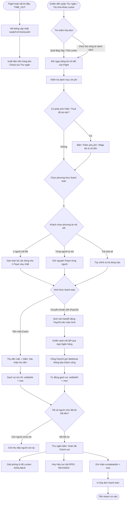

# QUY TRÌNH NGHIỆP VỤ: CHECK-OUT & QUYẾT TOÁN THANH TOÁN (CHECKOUT & PAYMENT MODULE)

> **Tài liệu Phân tích Nghiệp vụ & Đặc tả Kỹ thuật**  
> **Module:** Flight Settlement, Split Billing, Multi-gateway Payment (Cash / PayOS / SePay), Resource Deallocation  
> **Phiên bản:** 1.0 | **Ngày lập:** 2026-10-23  
> **Tác giả:** Senior Business Analyst & Technical Writer

---

## 1. TỔNG QUAN & PHẠM VI NGHIỆP VỤ

Module Check-out & Quyết toán thanh toán là khâu chốt chặn tài chính cuối cùng trong chu trình phục vụ của sân golf:
1. **Tiếp nhận lượt khách hoàn thành thi đấu:** Chỉ kích hoạt khi vòng chơi chuyển sang trạng thái `TIME_OUT` hoặc nhận tín hiệu `readyForCheckoutAt` từ phân hệ Điều hành xuất phát (Starter).
2. **Tổng hợp bảng kê chi phí hợp nhất (Consolidated Billing):** Tự động bóc tách và tổng hợp tất cả các khoản chi phí phát sinh trong ngày: Tiền sân Green fee, Phí Caddie, Thuê xe Buggy, Dịch vụ Booking ban đầu, và các phụ phí phát sinh tại sân (F&B nhà hàng, Kiosk nước, thuê đồ ProShop, phí tủ Locker).
3. **Khấu trừ tài chính & Phân bổ người thanh toán (Split Billing / Reassign Payer):** Khấu trừ tiền cọc (`depositAmountCents`) hoặc tiền trả trước, cho phép chuyển giao khoản nợ giữa các thành viên (Một người bao trọn gói, từng người tự trả phần mình, hoặc chia sẻ chi phí).
4. **Quyết toán đa kênh:** Thanh toán tiền mặt (Cash) hoặc sinh mã VietQR động qua cổng PayOS / SePay cho khách quét trực tiếp tại quầy hoặc trên điện thoại.
5. **Thu hồi tài nguyên & Đóng hồ sơ:** Giải phóng tủ Locker, hủy kích hoạt thẻ RFID (`REVOKED`), xác nhận hoàn tất Check-out (`completedAt`) và in hóa đơn chi tiết.

---

## 2. BẢN ĐỒ GIAO DIỆN, API, SERVICE VÀ DATABASE

### 2.1. Màn hình giao diện (Screens / Webapp Components)
- **Màn hình Danh sách chờ Check-out:** [`apps/webapp/src/app/(admin)/business/operations/check-out/page.tsx`](file:///d:/Projects/alogolf/apps/webapp/src/app/(admin)/business/operations/check-out/page.tsx)  
  *Component chính:* [`ReceptionOperationsPage variant="checkOut"`](file:///d:/Projects/alogolf/apps/webapp/src/features/reception/components/reception-operations-page.tsx).
- **Hộp thoại quét mã tìm kiếm lượt thanh toán:** [`reception-checkout-scan-dialog.tsx`](file:///d:/Projects/alogolf/apps/webapp/src/features/reception/components/reception-checkout-scan-dialog.tsx) cho phép Thu ngân quét nhanh thẻ Bag Tag hoặc thẻ tủ Locker của golfer để mở ngay bảng thanh toán tương ứng mà không cần tìm kiếm thủ công.
- **Hộp thoại quyết toán tổng hợp (Reception Checkout Dialog):** [`reception-checkout-dialog.tsx`](file:///d:/Projects/alogolf/apps/webapp/src/features/reception/components/reception-checkout-dialog.tsx) hiển thị tóm tắt: Tổng bill, Số tiền đã thanh toán, Tiền phụ phí phát sinh, Số tiền còn nợ (`amountDue`).
- **Bảng chi tiết thanh toán theo từng người chơi (Player Checkout Dialog):** [`reception-player-checkout-dialog.tsx`](file:///d:/Projects/alogolf/apps/webapp/src/features/reception/components/reception-player-checkout-dialog.tsx) và [`reception-payment-details-dialog.tsx`](file:///d:/Projects/alogolf/apps/webapp/src/features/reception/components/reception-payment-details-dialog.tsx):
  - Danh sách từng dòng chi phí (`lines`): Green fee, Caddie fee, Buggy fee, Add-ons, Extra charges.
  - Cột Người thụ hưởng (`Beneficiary`) và Người chi trả (`Payer`).
  - Nút đổi người thanh toán (`Reassign Payer`).
  - Nút thêm phụ phí thủ công (`Add Charge Line`).
- **Modal Thanh toán QR Động PayOS:** [`reception-payment-link-modal.tsx`](file:///d:/Projects/alogolf/apps/webapp/src/features/reception/components/reception-payment-link-modal.tsx) hiển thị mã VietQR động có logo ngân hàng, số tiền chính xác từng đồng và nội dung chuyển khoản tự sinh.
- **Mẫu in hóa đơn chi tiết (Print Invoice Sheet):** [`checkout-print-view.tsx`](file:///d:/Projects/alogolf/apps/webapp/src/features/reception/components/checkout-print-view.tsx) hỗ trợ in khổ A4 / A5 hoặc in nhiệt k80 cho khách.

### 2.2. Danh mục API Endpoints (Billing & Payment Controllers)
Khai báo tại [`FlightPaymentController`](file:///d:/Projects/alogolf/libs/backend/bookings/src/lib/controllers/flight-payment.controller.ts) và [`VisitCheckInController`](file:///d:/Projects/alogolf/libs/backend/bookings/src/lib/controllers/visit-check-in.controller.ts):

| Phương thức | Đường dẫn API | Quyền CASL | Tác vụ nghiệp vụ |
| :--- | :--- | :--- | :--- |
| `GET` | `/organizations/:orgId/flights/:flightId/payment-details` | `RequireAnyAbility(ReceptionOps, KioskOps)` | Lấy toàn bộ bảng kê chi phí, danh sách golfer, ai trả cho ai và số tiền còn nợ |
| `POST` | `/organizations/:orgId/flights/:flightId/payment-lines` | `RequireAbility(update, ReceptionOps)` | Thêm thủ công 1 dòng phụ phí (Ăn uống, thuê gậy, mua bóng ProShop...) |
| `DELETE`| `/organizations/:orgId/flights/:flightId/payment-lines` | `RequireAbility(update, ReceptionOps)` | Xóa dòng phụ phí thủ công đã thêm trước đó |
| `PATCH` | `/organizations/:orgId/flights/:flightId/payment-assignments`| `RequireAnyAbility(ReceptionOps, KioskOps)`| Đổi người thanh toán cho từng khoản chi phí (Gán golfer A trả cho B) |
| `POST` | `/organizations/:orgId/flights/:flightId/players/:guestId/checkout`| `RequireAnyAbility(ReceptionOps, KioskOps)`| Thanh toán cho 1 golfer cụ thể (Phương thức: `CASH` hoặc `PAYOS`) |
| `DELETE`| `/organizations/:orgId/flights/:flightId/players/:guestId/payos-pending`| `RequireAnyAbility(ReceptionOps, KioskOps)`| Hủy mã QR PayOS đang chờ khi khách đổi ý muốn trả tiền mặt |
| `POST` | `/organizations/:orgId/visit-check-ins/:id/checkout` | `RequireAnyAbility(ReceptionOps, KioskOps)` | Đóng lượt khách, kiểm tra nợ = 0, giải phóng Locker & thu hồi thẻ RFID |
| `POST` | `/payment/webhook` | `Public()` (Kèm chữ ký bảo mật SDK) | Webhook từ cổng PayOS / SePay thông báo khách đã chuyển khoản thành công |

### 2.3. Logic xử lý Backend & Dẫn chứng mã nguồn
1. **Xây dựng bảng chi phí hợp nhất (Consolidated Lines Builder):** [`FlightPaymentDetailsService.getPaymentDetails`](file:///d:/Projects/alogolf/libs/backend/bookings/src/lib/services/flight-payment/flight-payment-details.service.ts#L146-L190):
   - Gọi [`buildFlightPaymentLines`](file:///d:/Projects/alogolf/libs/backend/bookings/src/lib/services/flight-payment/flight-payment-lines.builder.ts):
     - Dòng `GREEN_FEE`: Lấy giá từ bảng giá `PricingTimeSlot` đã áp dụng khi đặt hoặc theo số lỗ thực chơi (9 hoặc 18 lỗ).
     - Dòng `CART` (Xe điện): Tính theo số lượng xe gán cho flight trong `FlightCart` và chính sách chia đầu người (`PER_PLAYER` hoặc `PER_CART`).
     - Dòng `CADDY` (Phí phục vụ caddie): Tính trên số lượng caddie thực tế phục vụ người chơi.
     - Dòng `ADDON`: Các dịch vụ đặt trước từ `BookingAddonLine` (ví dụ: thuê ô, thuê giày, bóng tập range).
     - Dòng `CHARGE`: Các chi phí phát sinh tại chỗ lưu trong bảng `VisitCharge` (F&B nhà hàng, quầy giải khát Kiosk hố số 10...).
   - Kiểm tra các khoản phân bổ đã được thanh toán (`settledAt != null`) hay đang chờ (`paymentPending = true`).
2. **Đổi người chi trả (Reassign Payer):** [`FlightPaymentDetailsService.patchAssignment`](file:///d:/Projects/alogolf/libs/backend/bookings/src/lib/services/flight-payment/flight-payment-details.service.ts#L192-L305):
   - Kiểm tra dòng chi phí chưa bị quyết toán (`line.settledAt == null`).
   - Cập nhật bản ghi [`FlightCostAssignment`](file:///d:/Projects/alogolf/libs/backend/database/prisma/models/flight-cost-assignment.prisma#L1-L25): Đặt `payerGuestId` thành mã của golfer chịu trách nhiệm trả khoản này.
3. **Thanh toán tiền mặt (Cash Payment):** [`FlightPaymentDetailsService.checkoutPlayerCash`](file:///d:/Projects/alogolf/libs/backend/bookings/src/lib/services/flight-payment/flight-payment-details.service.ts#L571-L650):
   - Lọc tất cả các dòng chi phí chưa thanh toán mà golfer này được gán làm `payerGuestId`.
   - Cập nhật `FlightCostAssignment.settledAt = now()` trong transaction.
   - Hủy bỏ các link PayOS đang chờ trước đó (`status = 'CANCELLED'`).
   - Cập nhật số tiền đã trả vào `Booking.paidAmountCents`. Nếu toàn bộ bill booking đã đủ tiền, tự động chuyển `Booking.paymentStatus = 'PAID'`.
4. **Thanh toán qua Cổng PayOS / VietQR:** [`FlightPaymentDetailsService.checkoutPlayerPayos`](file:///d:/Projects/alogolf/libs/backend/bookings/src/lib/services/flight-payment/flight-payment-details.service.ts#L473):
   - Sinh mã giao dịch duy nhất `orderCode` bằng hàm `generatePayosOrderCode` và số hóa đơn `orderInvoiceNumber`.
   - Gọi SDK PayOS tạo Payment Link chứa mã VietQR chuẩn NAPAS247 kèm tên tài khoản thụ hưởng của sân golf.
   - Lưu bản ghi `PaymentTransaction` với trạng thái `PENDING`.
   - Gắn `paymentTransactionId` vào các dòng chi phí trong `FlightCostAssignment` để đánh dấu đang chờ thanh toán (`paymentPending = true`).
5. **Xử lý Webhook cổng thanh toán:** [`BookingPaymentWebhookService.handleWebhook`](file:///d:/Projects/alogolf/libs/backend/payments/src/lib/services/booking-payment-webhook.service.ts):
   - Kiểm tra chữ ký bảo mật webhook (Checksum HMAC-SHA256 của PayOS hoặc `X-Secret-Key` của SePay).
   - Kiểm tra tính duy nhất chống xử lý lặp lại (Idempotency) qua bảng `PaymentWebhookDelivery`.
   - Cập nhật `PaymentTransaction.status = 'CAPTURED'`.
   - Đánh dấu `settledAt = now()` cho toàn bộ các dòng chi phí `FlightCostAssignment` gắn liền với giao dịch này.
   - Tự động gọi [`completeVisitsIfBookingLinesSettled`](file:///d:/Projects/alogolf/libs/backend/bookings/src/lib/services/flight-payment/complete-visits-if-booking-lines-settled.ts) để kiểm tra đóng hồ sơ khách.
6. **Thủ tục đóng lượt khách (Visit Checkout):** [`VisitLifecycleService.checkout`](file:///d:/Projects/alogolf/libs/backend/bookings/src/lib/services/visits/visit-lifecycle.service.ts#L348-L450):
   - Kiểm tra điều kiện tiên quyết: `visit.readyForCheckoutAt != null` (Trận chơi đã hoàn thành).
   - Kiểm tra toàn bộ công nợ đã được thanh toán đầy đủ (`ensureBookingPaidForVisitCheckout`).
   - Gọi [`LockerAssignmentService.releaseByVisit`](file:///d:/Projects/alogolf/libs/backend/bookings/src/lib/services/visits/visit-lifecycle.service.ts#L423): Chuyển trạng thái tủ Locker về `AVAILABLE`.
   - Hủy hiệu lực thẻ vật lý RFID (`PhysicalCard.status = 'REVOKED'`, `revokedAt = now()`).
   - Đánh dấu `VisitCheckIn.completedAt = now()`.

---

## 3. SƠ ĐỒ NGHIỆP VỤ CHECK-OUT & QUYẾT TOÁN

---

## 4. CHI TIẾT CÁC DANH MỤC CHI PHÍ TRONG BẢNG KÊ (LINE CATEGORIES)

Theo bảng phân loại tại [`flight-payment-lines.builder.ts`](file:///d:/Projects/alogolf/libs/backend/bookings/src/lib/services/flight-payment/flight-payment-lines.builder.ts#L114-L120):

| Phân nhóm (`Category`) | Mã định danh (`lineKey`) | Diễn giải chi tiết | Quy tắc tính & Phân bổ mặc định |
| :--- | :--- | :--- | :--- |
| **`GREEN_FEE`** | `green_fee:<guestId>` | Tiền sân phát bóng | Tính theo số lỗ chơi (9/18 lỗ), khung giờ sáng/chiều, thứ trong tuần. Mặc định gán cho chính golfer đó. |
| **`CADDY`** | `caddy:<guestId>` | Phí phục vụ của caddie | Phí dịch vụ caddie kèm theo tiêu chuẩn vòng đấu. Gán cho chính golfer sử dụng caddie. |
| **`CART`** | `cart:<cartId>:<guestId>` | Phí thuê xe điện Buggy | Tùy theo cấu hình sân: Tính trọn gói theo xe (`PER_CART`) chia đôi cho 2 người ngồi chung xe, hoặc tính theo đầu người (`PER_PLAYER`). |
| **`ADDON`** | `addon:<addonId>` | Dịch vụ đặt trước | Các gói phụ trợ đã chọn lúc đặt booking: Thuê gậy cao cấp, bóng golf, suất ăn trưa clubhouse. |
| **`CHARGE`** | `charge:<chargeId>` | Phụ phí phát sinh tại sân | Chi phí ăn uống tại nhà hàng (`RESTAURANT`), đồ uống Kiosk giữa sân (`POS`), phụ phí mượn thêm tủ đồ (`LOCKER`), hoặc phí phạt hỏng đồ (`MANUAL`). |

---

## 5. CÁC TÌNH HUỐNG NGOẠI LỆ & XỬ LÝ LỖI THANH TOÁN

1. **Khách đã quét QR chuyển khoản nhưng giao dịch bị treo (Chưa thấy gạch nợ):**
   - *Nguyên nhân:* Mạng ngân hàng Napas xử lý chậm hoặc ứng dụng ngân hàng của khách trừ tiền nhưng webhook chưa đến kịp.
   - *Cách xử lý của Thu ngân:*
     - Kiểm tra lịch sử giao dịch trên cổng quản trị PayOS/SePay hoặc sao kê tài khoản ngân hàng của sân golf.
     - Nếu tiền đã vào tài khoản sân: Thu ngân có thể chọn phương thức "Xác nhận tiền mặt/Đã nhận chuyển khoản" (`CASH` / update manual status) để gạch nợ ngay cho khách, tránh bắt khách phải đứng chờ tại sảnh.
2. **Khách muốn hủy mã QR đang hiển thị để chuyển sang trả tiền mặt:**
   - Thu ngân bấm nút "Hủy liên kết thanh toán" trên màn hình. Hệ thống gọi API `DELETE /players/:id/payos-pending` ([`flight-payment.controller.ts:125`](file:///d:/Projects/alogolf/libs/backend/bookings/src/lib/controllers/flight-payment.controller.ts#L125)) để giải phóng khóa nợ và cho phép chuyển sang thu tiền mặt ngay lập tức.
3. **Một golfer đứng ra nhận thanh toán cho toàn bộ nhóm bạn (Group Billing):**
   - Thu ngân mở `reception-payment-details-dialog.tsx`.
   - Chọn tính năng "Gán toàn bộ cho một người trả" (`Reassign All to Payer`).
   - Hệ thống cập nhật trường `payerGuestId` của tất cả các dòng chi phí về ID của golfer đại diện. Bảng kê của các golfer khác sẽ hiển thị số tiền phải trả = 0 VND.
4. **Khách quên trả chìa khóa / thẻ RFID tủ Locker:**
   - Hệ thống cảnh báo khi Thu ngân bấm "Hoàn tất Check-out". Thu ngân phải thu lại thẻ vật lý trước khi hoàn tất để đảm bảo an toàn tài sản sân golf.

---

## 6. DANH MỤC ĐIỂM CHƯA ĐỦ BẰNG CHỨNG (CẦN XÁC NHẬN)

1. `[CẦN XÁC NHẬN]` **Chính sách xuất hóa đơn giá trị gia tăng (VAT Invoice):** Hệ thống có tự động tích hợp với nhà cung cấp Hóa đơn điện tử (như VNPT Invoice, MISA meInvoice, Viettel S-Invoice) để tự sinh hóa đơn điện tử khi thanh toán thành công hay kế toán sân xuất hóa đơn thủ công cuối ngày?
2. `[CẦN XÁC NHẬN]` **Chính sách tích lũy điểm hội viên và chiết khấu hạng thẻ:** Trong bảng kê thanh toán, việc giảm giá cho hội viên (Member Tier: Đồng, Bạc, Vàng, Kim Cương theo `OrganizationGuestMemberTier`) được tự động áp dụng trực tiếp vào dòng Green fee hay hiển thị thành một dòng chiết khấu riêng biệt (`DISCOUNT`)?
3. `[CẦN XÁC NHẬN]` **Xử lý khoản thừa/thiếu nhỏ khi chuyển khoản:** Nếu bill là 2.500.200 VND nhưng khách chỉ chuyển chẵn 2.500.000 VND (lệch 200 đồng), webhook PayOS có chấp nhận dung sai (tolerance threshold) để tự động gạch nợ hay giữ nguyên trạng thái chưa hoàn tất?
