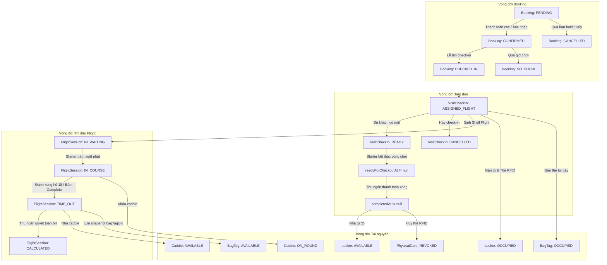

# MA TRẬN TRẠNG THÁI HỆ THỐNG & QUẢN TRỊ TÌNH HUỐNG NGOẠI LỆ

> **Tài liệu Phân tích Nghiệp vụ Chuyên sâu**  
> **Chủ đề:** Cross-Entity State Machine, Lifecycle Transition Matrix & Edge Case Management  
> **Phiên bản:** 1.0 | **Ngày lập:** 2026-10-23  
> **Tác giả:** Senior Business Analyst & Technical Writer

---

## 1. TỔNG QUAN MA TRẬN TRẠNG THÁI ĐA THỰC THỂ (CROSS-ENTITY STATE MACHINE)

Hệ thống quản lý sân golf AloGolf vận hành dựa trên cơ chế điều phối trạng thái liên kết chặt chẽ giữa 8 thực thể dữ liệu chính. Bất kỳ sự thay đổi trạng thái ở một thực thể đều kích hoạt các hiệu ứng phụ (side-effects) lên các thực thể còn lại để đảm bảo tính toàn vẹn dữ liệu:

---

## 2. BẢNG ĐỐI CHIẾU MA TRẬN TRẠNG THÁI LIÊN HOÀN (LIFECYCLE TRANSITION MATRIX)

Bảng đối chiếu trạng thái đồng thời giữa các thực thể qua 6 giai đoạn vận hành chính:

| Giai đoạn nghiệp vụ | `Booking.status` | `VisitCheckIn.status` | `FlightSession.status` | `BagTag.status` | `Locker.status` | Trạng thái Caddie | Trạng thái Thanh toán |
| :--- | :--- | :--- | :--- | :--- | :--- | :--- | :--- |
| **1. Khởi tạo đơn đặt** | `PENDING` | *(Chưa có)* | *(Chưa có)* | `AVAILABLE` | `AVAILABLE` | `AVAILABLE` | `PENDING` (Chờ cọc) |
| **2. Xác nhận đặt chỗ** | `CONFIRMED` | *(Chưa có)* | *(Chưa có)* | `AVAILABLE` | `AVAILABLE` | `AVAILABLE` | `DEPOSIT_PAID` / `PAID` |
| **3. Check-in tại quầy** | `CHECKED_IN` | `ASSIGNED_FLIGHT` -> `READY` | `IN_WAITING` *(Shell Flight)* | `OCCUPIED` | `OCCUPIED` | `AVAILABLE` *(Đã gán trước)* | Giữ nguyên trạng thái cọc |
| **4. Thi đấu trên sân** | `CHECKED_IN` | `READY` | `IN_COURSE` | `OCCUPIED` | `OCCUPIED` | `ON_ROUND` *(Khóa ca)* | Giữ nguyên trạng thái cọc |
| **5. Kết thúc vòng chơi** | `CHECKED_IN` | `readyForCheckoutAt != null` | `TIME_OUT` | `AVAILABLE` *(Nhả kho)* | `OCCUPIED` | `AVAILABLE` *(Tích lũy hố)* | Xuất hiện nợ cần thu (`amountDue`) |
| **6. Check-out hoàn tất** | `CHECKED_IN` | `completedAt != null` | `CALCULATED` | `AVAILABLE` | `AVAILABLE` *(Nhả tủ)* | `AVAILABLE` | `PAID` (`settledAt != null`) |

---

## 3. ĐẶC TẢ CHI TIẾT 10 KỊCH BẢN NGOẠI LỆ & GIẢI PHÁP HỆ THỐNG

### Kịch bản 1: Khách hủy đặt chỗ trước giờ chơi (Cancellation & Hold Refund)
- **Tình huống:** Golfer đặt chỗ trước 3 ngày nhưng bận việc đột xuất muốn hủy đơn trước giờ phát bóng 24 giờ.
- **Quy trình xử lý thực tế:**
  1. Khách bấm "Hủy đặt chỗ" trên app (`POST /bookings/:id/cancel`) hoặc gọi điện nhờ Lễ tân thao tác (`PATCH /bookings/:id`).
  2. Hàm [`BookingsUpdateService.cancel`](file:///d:/Projects/alogolf/libs/backend/bookings/src/lib/services/booking/bookings-update.service.ts) kiểm tra trạng thái booking: Phải là `PENDING` hoặc `CONFIRMED` (Chưa check-in).
  3. Cập nhật `Booking.status = 'CANCELLED'` và lưu thời điểm `cancelledAt = now()`.
  4. Hệ thống giải phóng slot giữ chỗ trên bảng `TeeTime`, kích hoạt logic tự động đôn khách trong hàng đợi (`BookingWaitlistPromoteService`).
  5. `[CẦN XÁC NHẬN]` Khoản tiền cọc đã thanh toán (`paidAmountCents`): Hiện tại hệ thống chưa tích hợp hoàn tiền tự động qua API cổng thanh toán, Thu ngân cần kiểm tra chính sách hủy (trước bao nhiêu tiếng được hoàn cọc) để chuyển khoản thủ công hoặc bảo lưu voucher cho khách.

---

### Kịch bản 2: Khách không đến sân phát bóng (No-Show Handling)
- **Tình huống:** Khách có đơn đặt trạng thái `CONFIRMED` nhưng quá giờ Tee Time mà không có mặt làm thủ tục và không liên hệ với sân.
- **Quy trình xử lý thực tế:**
  1. Tiến trình ngầm định kỳ (Cron Job) gọi hàm [`BookingNoShowService.sweepNoShows`](file:///d:/Projects/alogolf/libs/backend/bookings/src/lib/services/booking/booking-no-show.service.ts).
  2. Hệ thống tìm kiếm các đơn `CONFIRMED` có `teeTime.teeOffAt` đã trôi qua một khoảng thời gian đệm (Buffer time).
  3. Tự động cập nhật `Booking.status = 'NO_SHOW'` và ghi nhận thời điểm `noShowAt = now()`.
  4. Slot Tee Time được đóng hoàn toàn để ghi nhận báo cáo năng lực phục vụ thực tế của sân.
  5. `[CẦN XÁC NHẬN]` Tài khoản golfer vi phạm có bị hệ thống tự động khóa quyền đặt chỗ online trong vòng 30 ngày hoặc đưa vào danh sách đen (Blacklist) hay không?

---

### Kịch bản 3: Hủy thủ tục Check-in (Check-in Rollback & Resource Reclaim)
- **Tình huống:** Lễ tân đã làm thủ tục check-in, cấp thẻ tủ và gán thẻ túi gậy, nhưng sau đó khách có việc khẩn cấp phải rời sân ngay trước khi ra bến xuất phát.
- **Quy trình xử lý thực tế:**
  1. Lễ tân vào màn hình Check-in, chọn nhóm khách và bấm "Hủy Check-in" (`POST /visit-check-ins/:id/cancel`).
  2. Hàm [`VisitLifecycleService.cancelVisit`](file:///d:/Projects/alogolf/libs/backend/bookings/src/lib/services/visits/visit-lifecycle.service.ts#L250-L346) thực hiện giao dịch hoàn nguyên:
     - Chuyển `VisitCheckIn.status = 'CANCELLED'`.
     - Hoàn trả `Booking.status = 'CONFIRMED'`.
     - Xóa dữ liệu điểm danh: `checkedInAt = null`, `bagTagId = null`, `lockerId = null` trên từng `BookingPlayer`.
     - Thu hồi hiệu lực thẻ RFID: `PhysicalCard.status = 'REVOKED'`.
     - Nhả tủ Locker về trạng thái `AVAILABLE`.
     - Hủy FlightSession vỏ đang chờ (`IN_WAITING`) tại bến xuất phát với lý do `cancelReason = 'Visit check-in cancelled'`.
     - Giải phóng caddie về trạng thái sẵn sàng nhận việc.

---

### Kịch bản 4: Xung đột tài nguyên trùng lặp tại bến Starter (Buggy / Caddie Collision)
- **Tình huống:** Nhân viên Starter tại bến gán xe điện số 08 và Caddie số 12 vào Flight mới, nhưng xe 08 hoặc Caddie 12 đang được ghi nhận ở một Flight khác chưa xuất phát hoặc chưa kết thúc.
- **Quy trình xử lý thực tế:**
  1. Hàm [`StarterFlightsCreateBase.cancelConflicts`](file:///d:/Projects/alogolf/libs/backend/flights/src/lib/services/starter-flights/starter-flights-create-base.ts#L55-L151) tự động kích hoạt kiểm tra chéo trước khi lưu DB.
  2. Hệ thống quét bảng `FlightCart` và `FlightGuest`:
     - Nếu phát hiện xe điện đang nằm trong flight khác chưa hủy: Tự động ngắt xe khỏi flight cũ hoặc đánh dấu hủy flight cũ với mã lý do `CONFLICT_CART`.
     - Nếu phát hiện Caddie đang được gán ở flight khác: Tự động ngắt caddie khỏi flight cũ với mã lý do `CONFLICT_CADDIE`.
  3. Ghi vết toàn bộ sự thay đổi vào bảng lịch sử điều phối `FlightAssetAssignmentHistory` để phục vụ công tác hậu kiểm.

---

### Kịch bản 5: Chuyển Golfer giữa các Flight (Transfer Golfer)
- **Tình huống:** Golfer A đến sân sớm, muốn xin đi cùng Flight xuất phát lúc 07:15 thay vì Flight ban đầu của mình lúc 07:45.
- **Quy trình xử lý thực tế:**
  1. Starter mở dialog [`starter-flight-transferable-guests-dialog.tsx`](file:///d:/Projects/alogolf/apps/webapp/src/features/starter-flights/components/starter-flight-transferable-guests-dialog.tsx).
  2. Chọn Flight đích (Flight 07:15) và tìm kiếm Golfer A từ danh sách khách khả dụng trong ngày.
  3. Hàm [`StarterFlightsTransferableGuestsService`](file:///d:/Projects/alogolf/libs/backend/flights/src/lib/services/starter-flights/starter-flights-transferable-guests.service.ts) cập nhật:
     - Di chuyển bản ghi `FlightGuest` từ flight nguồn sang flight đích.
     - Cập nhật số lượng người chơi trên cả 2 flight.
     - Đồng bộ lại cấu trúc chi phí trong `FlightCostAssignment` để đảm bảo khi đến quầy thanh toán, chi phí của Golfer A sẽ hiển thị chính xác theo Flight thực tế mà khách đã chơi.

---

### Kịch bản 6: Ghép và Tách Flight trên sân (Merge & Split Flights)
- **Tình huống:** Hai nhóm khách đi lẻ (Nhóm 1 có 2 khách, Nhóm 2 có 2 khách) có giờ chơi liền kề, Starter muốn gộp chung thành một nhóm 4 người để giải phóng đường chơi cho các nhóm phía sau.
- **Quy trình xử lý thực tế:**
  1. Starter thực hiện thao tác Ghép Flight trên phần mềm.
  2. Hàm [`FlightMergeService.merge`](file:///d:/Projects/alogolf/libs/backend/flights/src/lib/services/starter-flights/flight-merge.service.ts) chuyển toàn bộ các bản ghi `FlightGuest` của Flight 2 sang Flight 1.
  3. Kiểm tra số lượng người sau khi gộp không được vượt quá 4 khách (`maxPlayersPerTeeTime = 4`).
  4. Flight 2 được chuyển trạng thái `CANCELLED` với lý do `cancelReason = 'Merged into Flight [Mã Flight 1]'`.
  5. Khi kết thúc vòng đấu, Thu ngân mở Flight 1 sẽ thấy đầy đủ danh sách 4 golfer kèm các mã Booking gốc tương ứng để thanh toán độc lập.

---

### Kịch bản 7: Sự cố thời tiết gián đoạn thi đấu (Rain Check / Weather Interruption)
- **Tình huống:** Sân xảy ra mưa giông lớn kèm sấm sét sau khi khách mới chơi được 5 hố. Ban điều hành quyết định dừng trận đấu khẩn cấp vì lý do an toàn.
- **Quy trình xử lý thực tế:**
  1. Starter phát lệnh dừng thi đấu, trên phần mềm bấm "Hoàn tất Flight khẩn cấp" (`complete`) để đưa toàn bộ khách về nhà câu lạc bộ (Clubhouse).
  2. Toàn bộ hố chưa chơi được hệ thống chuyển sang trạng thái `SKIPPED`.
  3. Khi khách vào quầy Thu ngân:
     - Bảng chi phí mặc định vẫn hiển thị giá vòng 18 hố ban đầu.
     - Thu ngân sử dụng tính năng "Thêm dòng giảm trừ / Voucher" (`POST /flights/:id/payment-lines`) với giá trị âm (hoặc chiết khấu) tương ứng với số hố chưa chơi.
  4. `[CẦN XÁC NHẬN]` Sân có áp dụng chính sách cấp phiếu chơi bù "Rain Check Voucher" cho 13 hố còn lại hay hoàn tiền mặt trực tiếp cho khách?

---

### Kịch bản 8: Khách đổi số hố chơi khi đang làm thủ tục (Hole Count Adjustment)
- **Tình huống:** Khách đặt trước 18 hố nhưng khi đến quầy check-in vì lý do sức khỏe muốn đổi xuống đánh 9 hố.
- **Quy trình xử lý thực tế:**
  1. Lễ tân mở form [`reception-check-in-edit-form.tsx`](file:///d:/Projects/alogolf/apps/webapp/src/features/reception/components/reception-check-in-edit-form.tsx), chọn lại số lỗ là `9`.
  2. Hệ thống gọi API `PATCH /bookings/:id/check-in-details`:
     - Ghi nhận `holeCountAdjustedAt = now()`.
     - Lưu lý do `holeCountAdjustedReason = 'Customer request at desk'`.
     - Lưu ID nhân viên thực hiện `holeCountAdjustedByAccountId`.
  3. Khi sinh Flight và tính bill tại quầy Thu ngân:
     - Hệ thống áp dụng hệ số giá 9 lỗ (`hole9Multiplier = 0.6`).
     - Lộ trình thi đấu trên sân của Starter chỉ phân bổ hành trình 9 hố (`FRONT_9_ONLY` hoặc `BACK_9_ONLY`).

---

### Kịch bản 9: Treo giao dịch thanh toán trực tuyến / Trùng lặp Webhook
- **Tình huống:** Khách quét mã VietQR PayOS, tài khoản khách đã bị trừ tiền nhưng màn hình Thu ngân vẫn chưa tự động chuyển sang trạng thái đã thanh toán do độ trễ mạng viễn thông.
- **Quy trình xử lý thực tế:**
  1. Thu ngân kiểm tra mã tham chiếu đơn hàng (`providerMerchantOrderRef`) trên phần mềm quản trị cổng PayOS.
  2. Nếu xác nhận tiền đã vào tài khoản ngân hàng của sân:
     - Thu ngân bấm chọn phương thức "Xác nhận đã nhận chuyển khoản" (Manual Settle via Cash/Bank Transfer option).
     - Hệ thống cập nhật gạch nợ tức thì để khách kịp giờ ra về.
  3. Đối với trường hợp Webhook gửi đến sau đó:
     - Hàm [`BookingPaymentWebhookService.handleWebhook`](file:///d:/Projects/alogolf/libs/backend/payments/src/lib/services/booking-payment-webhook.service.ts) kiểm tra tính duy nhất chống lặp (Idempotency) dựa trên `merchantOrderRef` trong bảng `PaymentWebhookDelivery`.
     - Nếu giao dịch đã được xử lý hoặc gạch nợ trước đó, Webhook trả về kết quả `DUPLICATE` mà không thực hiện cộng tiền hay gạch nợ lần hai.

---

### Kịch bản 10: Khách làm mất thẻ RFID / Quên trả chìa khóa tủ Locker
- **Tình huống:** Sau khi tắm xong, khách báo đánh mất thẻ từ RFID mở tủ đồ Locker.
- **Quy trình xử lý thực tế:**
  1. Lễ tân vào phân hệ quản lý Locker, tìm số tủ của khách.
  2. Sử dụng thẻ Master của quản lý để mở tủ thủ công cho khách lấy đồ đạc cá nhân.
  3. Thao tác trên phần mềm: Bấm nút "Thu hồi thẻ bị mất" (`Revoke Physical Card`). Hệ thống cập nhật `PhysicalCard.status = 'REVOKED'` để vô hiệu hóa hoàn toàn mã UID thẻ cũ, tránh kẻ gian nhặt được mở tủ đồ của khách sau.
  4. Thu ngân thêm dòng phụ phí "Phí đền bù mất thẻ Locker" (`MANUAL CHARGE`, ví dụ: 200.000 VND) vào hóa đơn thanh toán của khách.
  5. Tủ đồ được hoàn trả về kho tài nguyên để gán mã thẻ RFID mới.

---

## 4. TỔNG HỢP DANH MỤC CÁC QUY TẮC NGHIỆP VỤ CẦN XÁC NHẬN

Dưới đây là bảng tổng hợp toàn bộ các điểm nghiệp vụ chưa đủ bằng chứng tuyệt đối trong mã nguồn, cần được Ban Lãnh Đạo Sân Golf AloGolf phê duyệt chính thức trước khi triển khai thực địa:

| STT | Mã quy tắc | Tên quy tắc nghiệp vụ | Thực trạng mã nguồn hiện tại | Đề xuất chuẩn hóa từ Senior BA |
| :---: | :--- | :--- | :--- | :--- |
| 1 | `RULE-CONFIRM-01` | **Chính sách hoàn tiền cọc khi hủy Booking** | Hệ thống chỉ chuyển trạng thái đơn `CANCELLED`, chưa có cơ chế gọi Refund API cổng thanh toán. | Đề xuất: Hủy trước 24h hoàn 100% qua Voucher; hủy từ 12-24h hoàn 50%; hủy dưới 12h phạt 100% tiền cọc. |
| 2 | `RULE-CONFIRM-02` | **Thời gian quét No-Show tự động** | Có cron job quét nhưng tham số số phút trễ chưa được cấu hình tường minh trên UI quản trị. | Đề xuất: Cho phép cấu hình tham số `noShowGracePeriodMinutes` trên màn hình Cài đặt sân (Mặc định 30 phút). |
| 3 | `RULE-CONFIRM-03` | **Chính sách gián đoạn thời tiết (Rain Check)** | Thu ngân phải nhập dòng phụ phí giảm trừ thủ công bằng tay. | Đề xuất: Xây dựng bảng quy đổi tự động: Dưới 5 hố hoàn 100% vé chơi; từ 5-13 hố tính giá 9 hố; trên 13 hố tính trọn vẹn vòng 18 hố. |
| 4 | `RULE-CONFIRM-04` | **Chính sách nhóm chơi 5 người (5-ball flight)** | Mặc định cứng `maxPlayersPerTeeTime = 4`. | Đề xuất: Bổ sung cờ cấu hình `allowFiveBallOnWeekdays` kèm phụ thu phí phục vụ đặc biệt cho flight 5 người. |
| 5 | `RULE-CONFIRM-05` | **Chia doanh thu Caddie khi thay người giữa chặng** | Hệ thống ghi nhận số hố hoàn thành theo từng Caddie tại thời điểm kết thúc chặng. | Đề xuất: Caddie 1 hưởng tỉ lệ theo số hố thực tế đã phục vụ (ví dụ 9/18 hố), Caddie thay thế hưởng phần hố còn lại. |
| 6 | `RULE-CONFIRM-06` | **Tự động xuất Hóa đơn điện tử VAT** | Chưa thấy module kết nối trực tiếp với nhà cung cấp hóa đơn điện tử. | Đề xuất: Tích hợp API xuất hóa đơn điện tử tự động khi giao dịch đạt trạng thái `CAPTURED` và có thông tin MST. |
| 7 | `RULE-CONFIRM-07` | **Dung sai lệch tiền chuyển khoản ngân hàng** | Cổng thanh toán yêu cầu khớp chính xác 100% số tiền từng chữ số. | Đề xuất: Cài đặt ngưỡng dung sai chênh lệch cho phép dưới 1.000 VND để tránh giữ chân khách tại quầy chỉ vì vài trăm đồng lẻ. |
